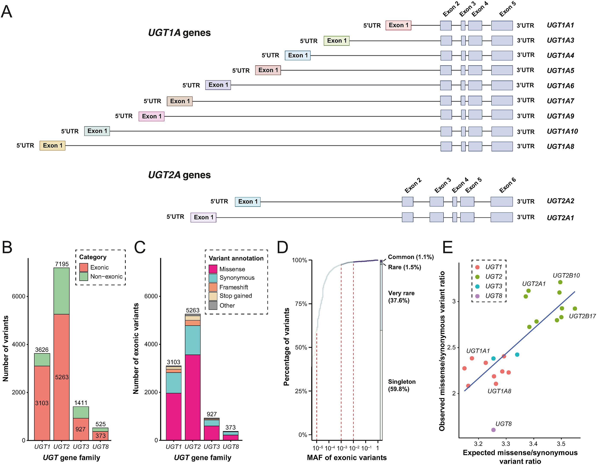
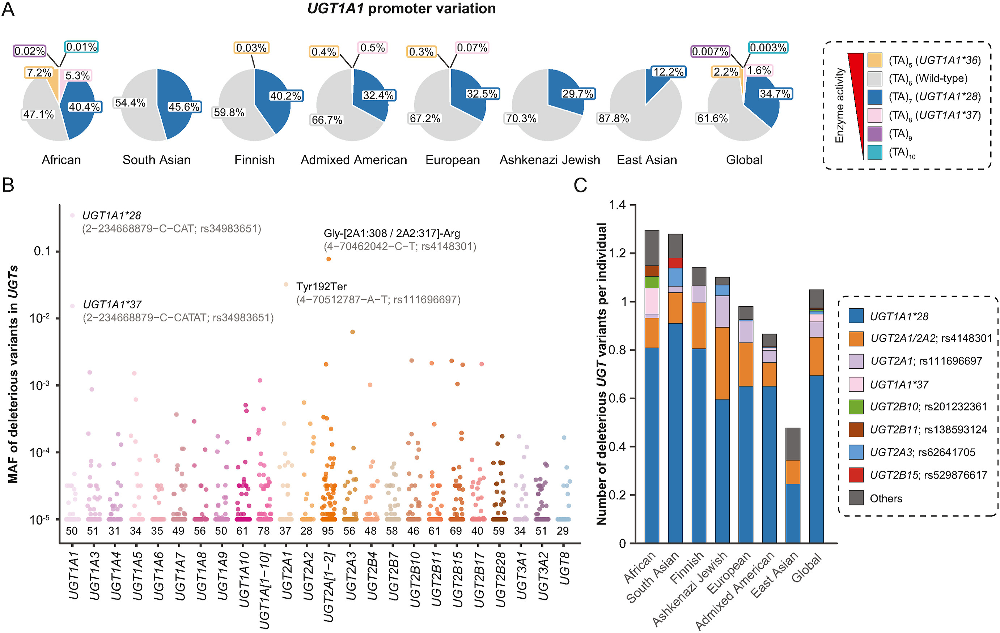

# Population-scale variability of the human UDP-glycosyltransferase gene family
This repository was created to maintain version control of this pharmacogenomics project at Karolinska Institutet (KI) under the supervision of Volker M. Lauschke and Yitian Zhou. 

## Abstract
Human UDP-glycosyltransferases (UGTs) are responsible for the glycosylation of a wide variety of endogenous substrates and commonly prescribed drugs. Different genetic polymorphisms in UGT genes are implicated in interindividual differences in drug response and cancer risk. However, the genetic complexity beyond these variants has not been comprehensively assessed. We here leveraged whole-exome and whole-genome sequencing data from 141,456 unrelated individuals across 7 major human populations to provide a comprehensive profile of genetic variability across the human UGT gene family. Overall, 9666 exonic variants were observed of which 98.9% were rare. To interpret the functional impact of UGT missense variants, we developed a gene family-specific variant effect predictor. This algorithm identified a total of 1208 deleterious variants, most of which were found in African and South Asian populations. Structural analysis corroborated the predicted effects for multiple variations in substrate binding sites. Combined, our analyses provide a systematic overview of UGT variability, which can yield insights into interindividual differences in phase 2 metabolism and facilitate the translation of sequencing data into personalized predictions of UGT substrate disposition.

  

**Global landscape of human UGT variability. A**: Schematic representation of the canonical transcripts of the UGT1A and UGT2A loci, including gene-specific and shared exons. **B**: The total number of variants across the four human UGT gene families is shown. **C**: The distribution of variant types is shown for all exonic variants. **D**: Of all exonic UGT variants, 98.9% and 97.4% were rare or very rare with global MAF <1% and <0.1%, respectively. Furthermore, 59.8% were singletons found only in one individual. **E**: Observed against expected missense-to-synonymous variant ratio indicates the mutational constraints of all human UGT genes. 
Abbreviations: MAF: minor allele frequency.

  

**Ethnogeographic variability within the human UGT gene family. A**: Frequency distribution of the UGT1A1 promoter polymorphism across seven human populations. **B**: MAFs of putatively deleterious variants across all UGT genes. Only the variants that map to gene-specific exons are shown for each gene. Variants localized in shared exons of the UGT1A or UGT2A loci are shown as UGT1A[1−10] and UGT2A[1−2], respectively. **C**: The average number of deleterious UGT variants per individual is shown for different populations. The eight variants responsible for the largest contributions to overall functional variability are shown individually. 

## Data access
No raw data were generated in this project. All used data can be directly downloaded from the corresponding cited sources (gnomAD, Ensembl, ClinVar, AlphaMissense, and COSMIC).

## Code availability 
All code run in `R`/Bash required to perform the analyses and produce the figures and results can be found in the [code](code/) section where they are carefully described. 

## Citation
Citation for the original publication:

> D. Gonzalez-Padilla, M.D. Camara, V.M. Lauschke et al., Population-scale variability of the human UDP-glycosyltransferase gene family, Journal of Genetics and Genomics, https://doi.org/10.1016/j.jgg.2024.06.018

Please use the following APA citation to cite this code repository as well as the data released by this project. 

> Daianna Gonzalez. (2024). daianna21/UGT_genetic_profiling_KI: v0_published (published). Zenodo. https://doi.org/10.5281/zenodo.13385483
